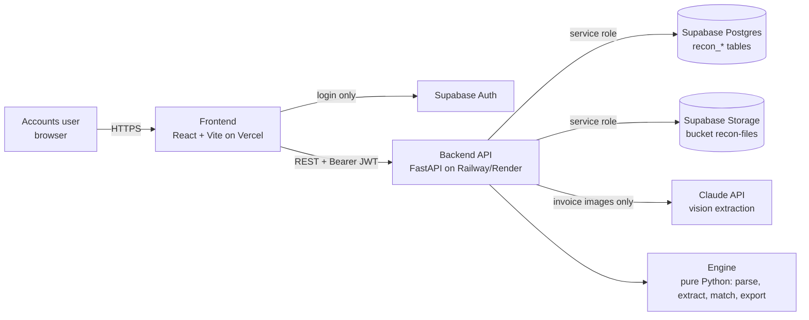
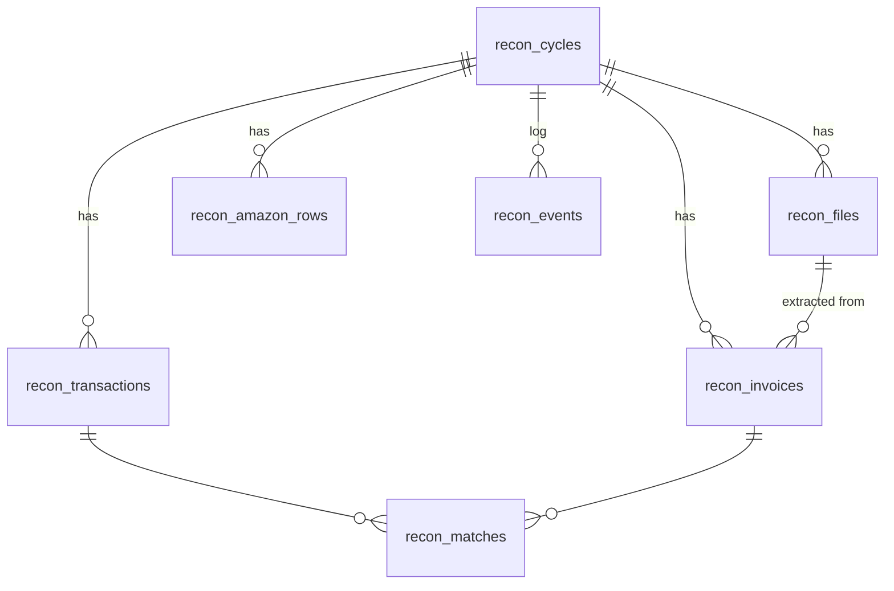

# Architecture

Companion to `project_context.md` (facts and rules) and `flow.md` (step-by-step flows).

## 1. System overview



- **Frontend:** handles UI only. It talks to Supabase **only to log in**. All data goes through the backend API.
- **Backend:**
  - Checks the user's JWT and the allowed-email list.
  - Stores files.
  - Runs processing as background tasks.
  - Calls the engine.
  - Writes results.
- **Engine:** a pure-Python package with **no database, network or storage calls** (except the vision client, which is injected). Everything that decides a result lives here and is unit-tested.
- **Supabase:**
  - Postgres holds our `recon_*` tables, with row-level security enabled and **no policies**, so only the service role can read or write them.
  - A private Storage bucket holds the files.
  - Auth handles users.
  - Existing tables in the same project are never touched.

## 2. Tech stack

| Layer | Choice | Notes |
|---|---|---|
| Backend | Python 3.12 in Docker (`requires-python >=3.11` for local dev), FastAPI, Pydantic v2, Uvicorn | |
| PDF text | `poppler-utils` (`pdftotext -layout`, `pdftoppm`) | Proven on the June statement and invoices. Installed in the Docker image |
| Data | `openpyxl` (Excel), stdlib `csv` (Amazon CSV), `zipfile` | |
| Fuzzy text | `rapidfuzz` | Only for vendor-alias matching if regex is not enough |
| Vision | Anthropic Python SDK | Model name in env `ANTHROPIC_MODEL`; never hard-code it |
| DB / storage client | `supabase` Python client (service role) | |
| Frontend | React 19 + Vite + TypeScript, Tailwind CSS v4 (`@tailwindcss/vite`), shadcn/ui (style `base-nova`, on `@base-ui/react`), lucide-react, sonner, `@fontsource-variable/inter`, TanStack Query, React Router | Matches the v0 export in `doc/design_reference/`. **No Next.js** |
| Auth (frontend) | `@supabase/supabase-js` | Email + password; sign-up disabled |
| Hosting | API: Docker on Railway (or Render). Frontend: Vercel. DB/Storage/Auth: existing Supabase project | |
| Tests | `pytest` (engine and API), run in Docker (`docker compose run --rm tests`) because they need poppler | Manual test cases per slice in `implementation_plan.md` |

## 3. Repository layout

```
/
├─ doc/                         # these documents (+ reference/ prototype scripts and fixture)
├─ supabase/
│  └─ migrations/               # NNNN_description.sql — user runs them manually in the SQL editor
├─ backend/
│  ├─ Dockerfile                # python:3.12-slim + poppler-utils
│  ├─ pyproject.toml
│  ├─ app/
│  │  ├─ main.py                # FastAPI app, CORS, routers
│  │  ├─ config.py              # settings from env (pydantic-settings)
│  │  ├─ auth.py                # verify Supabase JWT, allowed emails
│  │  ├─ db.py                  # supabase client (service role), small repository helpers
│  │  ├─ storage.py             # upload/download/signed URLs for bucket recon-files
│  │  ├─ api/
│  │  │  ├─ cycles.py
│  │  │  ├─ files.py
│  │  │  ├─ statement.py
│  │  │  ├─ invoices.py
│  │  │  ├─ results.py
│  │  │  └─ export.py
│  │  ├─ services/              # orchestration: load from DB/storage → engine → save
│  │  │  ├─ ingest.py           # zip expansion, hashing, file classification
│  │  │  ├─ process_statement.py
│  │  │  ├─ process_invoices.py
│  │  │  └─ run_matching.py
│  │  └─ engine/                # PURE: no DB, no HTTP (vision client injected)
│  │     ├─ money.py            # paise helpers, parsing "1,05,980.00"
│  │     ├─ statement_icici.py  # parse + validate against summary
│  │     ├─ invoices/
│  │     │  ├─ detect.py        # vendor detection from text
│  │     │  ├─ amazon.py        # multi-invoice split, order/invoice dates, TOTAL
│  │     │  ├─ macfos.py
│  │     │  ├─ indigo.py
│  │     │  ├─ dtdc.py
│  │     │  ├─ generic.py       # amounts, USD amounts, dates, invoice no.
│  │     │  └─ vision.py        # prompt + JSON schema; client passed in
│  │     ├─ amazon_csv.py       # parse Business Analytics reconciliation CSV
│  │     ├─ matcher.py          # rules 1–10 from project_context.md §8
│  │     └─ excel.py            # client-format workbook
│  └─ tests/
│     ├─ test_statement.py
│     ├─ test_invoices.py
│     ├─ test_matcher.py
│     ├─ test_excel.py
│     └─ fixtures_private/      # git-ignored: real June/September files
└─ frontend/
   ├─ index.html
   ├─ src/
   │  ├─ lib/api.ts             # fetch wrapper adding Bearer token
   │  ├─ lib/supabase.ts        # auth client only
   │  ├─ lib/format.ts          # ₹ en-IN formatting, dd/mm/yyyy dates
   │  ├─ pages/                 # Login, Cycles, NewCycle, CycleDetail (tabs)
   │  └─ components/            # from v0 design
   └─ .env.example
```

## 4. Data model (Postgres, all in `public` with prefix `recon_`)

Money: `*_paise bigint` for INR, `*_minor bigint` plus `currency text` for foreign amounts. Dates: `date`. IDs: `uuid default gen_random_uuid()`.



| Table | Purpose | Key columns |
|---|---|---|
| `recon_cycles` | One statement and its month of work | `id`, `label` (e.g. "June 2026"), `status`, `statement_date`, `period_start`, `period_end`, `summary_previous_paise`, `summary_purchases_paise` (printed Purchases/Charges **plus Cash Advances**: what the debit lines must add up to), `summary_credits_paise`, `summary_total_due_paise`, `statement_confirmed_at`, `statement_confirmed_by`, `job_kind` (`statement` / `invoices` / `matching`, migration 0004: whose job the next three columns describe), `job_status`, `job_progress`, `job_message`, `created_by`, `created_at`, `updated_at` |
| `recon_files` | Every uploaded or extracted file | `id`, `cycle_id`, `kind` (`statement` / `invoice` / `amazon_report` / `zip` / `ignored`), `original_name`, `storage_path`, `sha256`, `mime_type`, `size_bytes`, `parent_file_id` (for files from a ZIP), `status` (`uploaded` / `processed` / `failed` / `duplicate`), `note` (e.g. "copy of the statement"), `error`, `created_at`. **Partial** unique index on `(cycle_id, sha256) where status <> 'duplicate'`, so duplicates are recorded but never stored twice as live files |
| `recon_transactions` | Statement lines | `id`, `cycle_id`, `ser_no` (text), `txn_date`, `card_last4`, `description`, `reward_points`, `foreign_amount_minor`, `foreign_currency`, `amount_paise`, `is_credit`, `vendor_key`, `status`, `notes`, `sort_order`, `updated_by`, `updated_at`. Unique `(cycle_id, ser_no)` |
| `recon_invoices` | One row per invoice (a PDF may give several) | `id`, `cycle_id`, `file_id`, `block_index`, `vendor_key`, `invoice_no`, `order_id`, `invoice_date`, `order_date`, `currency`, `total_minor`, `amounts_minor` (`bigint[]`, candidate amounts), `extra` (`jsonb`: PNR, raw fields), `is_credit_note`, `source` (`pdf_text` / `vision` / `manual`), `extraction_status` (`pending` / `ok` / `needs_check` / `failed`), `duplicate_of`, `updated_at` |
| `recon_amazon_rows` | Parsed Amazon CSV rows | `id`, `cycle_id`, `file_id`, `order_id`, `order_date`, `payment_ref`, `payment_date`, `payment_method`, `card_last4`, `shipment_qty`, `net_total_paise` |
| `recon_matches` | Transaction ↔ invoice links (many-to-many) | `id`, `cycle_id`, `transaction_id`, `invoice_id`, `rule` (e.g. `amazon_subset`, `exact_inr`, `usd`, `manual`), `is_suggestion` (true for Review suggestions), `created_by` (null = system), `created_at`. Unique `(transaction_id, invoice_id)` |
| `recon_vendor_aliases` | Vendor configuration: how a vendor appears on the statement **and** on its invoices | `id`, `vendor_key` (unique), `display_name`, `statement_pattern` (regex on the statement description), `invoice_pattern` (regex on invoice text; the legal entity can differ, e.g. Periskope → "Hashlabs Holdings", Vistaprint → "Cimpress"), `match_mode` (`single` / `subset` / `none`), `date_before_days`, `date_after_days`, `active` |
| `recon_events` | Audit log of manual actions | `id`, `cycle_id`, `actor`, `action`, `payload` (`jsonb`), `created_at` |

**Status values:**

- **`recon_cycles.status`:** `draft` → `statement_parsed` → `statement_confirmed` → `invoices_extracted` → `matched` → `exported`. Errors go to `failed`, with the message in a `recon_events` row.
- **`recon_transactions.status`:** `Matched`, `Review`, `Missing invoice`, `No invoice`, `Reversed`, `Credit – manual`, `Payment`, `Bank charge`. Stored as text, with a CHECK constraint.

**Security:**

- Row-level security is **enabled with no policies** on every `recon_*` table, so the anon and authenticated roles cannot read or write them directly. The backend uses the service role.
- The bucket `recon-files` is private. The backend serves files through short-lived signed URLs.

**Storage paths:** `cycles/{cycle_id}/{file_id}/{safe_name}`. The original name stays in `recon_files.original_name`; `safe_name` is that name with anything outside letters, digits, `.`, `_`, `(`, `)` and `-` replaced by `_` (storage keys reject spaces, `$`, `=` and similar), so `Fathom $36.pdf` is stored as `Fathom_36.pdf`. Duplicates (same SHA-256 in the cycle) are recorded with no stored copy.

## 5. API (all under `/api`, Bearer JWT required except `/api/health`)

| Method & path | Purpose |
|---|---|
| `GET /api/health` | Liveness, plus version |
| `GET /api/me` | Current user email (checks allow-list) |
| `GET /api/cycles` | List cycles with status and counts |
| `POST /api/cycles` | Create a cycle (`label` optional; period comes from the statement) |
| `GET /api/cycles/{id}` | Cycle detail, summary counts |
| `DELETE /api/cycles/{id}` | Delete a cycle and its files (only if not exported) |
| `POST /api/cycles/{id}/files` | Multipart upload; field `kind` = `statement` / `invoices` / `amazon_report`. ZIPs are expanded |
| `GET /api/cycles/{id}/files` | Files with kind, status, duplicate flags |
| `POST /api/cycles/{id}/statement/parse` | Parse the statement (background); fills transactions and summary |
| `GET /api/cycles/{id}/statement` | Lines, plus parsed vs printed totals and pass/fail |
| `POST /api/cycles/{id}/statement/confirm` | Lock the statement (only if totals match) |
| `POST /api/cycles/{id}/invoices/extract` | Extract all invoice files (background; vision for images) |
| `GET /api/cycles/{id}/invoices` | Invoices with extraction status |
| `GET /api/cycles/{id}/amazon-report` | The uploaded Amazon Business report: row count, card payment groups (payment date, card, reference, distinct orders, amount) and gift-balance orders. Rows are read and saved at upload |
| `PATCH /api/invoices/{id}` | Correct vendor, number, dates, total |
| `POST /api/cycles/{id}/match` | Run matching (replaces system matches, keeps manual ones; 409 until the statement is confirmed). Returns **202** and works in the background; progress is on the cycle row (messages start with "Matching") and comes back as `job` in the summary below |
| `GET /api/cycles/{id}/match-summary` | Lines and signed amounts (credits negative) by status; `ran` is false before the first run; `job` is the matching run (`running` / `done` / `failed`) |
| `GET /api/cycles/{id}/transactions` | Results: status, files, notes, suggestions, and per line the attached sum, difference and foreign-currency comparison (worked out by `engine/results.py`); filters `status`, `vendor`, `card`, `q` (every word must be found in the description, serial number, amount, note, vendor or an attached file name) |
| `POST /api/transactions/{id}/resolve` | Body: `attach_invoice_ids[]`, `detach_invoice_ids[]`, `status`, `note`, `preview`. Returns the line. `preview: true` writes nothing and returns the line as it would be. 409 while matching runs, before a line is matched, for an exported reconciliation, or for an invoice used elsewhere; 422 for a status that is not Matched / Review / Missing invoice / No invoice, Matched with nothing attached, or a non-zero difference without a person's note |
| `GET /api/cycles/{id}/unused-invoices` | Read invoices not linked to any line (a Review suggestion reserves its invoices), with a reason each; filters `q`, `vendor` |
| `GET /api/files/{id}/url` | Signed URL to view a file |
| `POST /api/files/{id}/restore` | Bring back a file set aside with "Not an invoice" (only one a person set aside; a statement copy stays set aside). Returns the invoice list; `Read invoices` then reads it |
| `GET /api/cycles/{id}/amazon-to-fetch` | Amazon orders of the report's payment groups (one per statement charge) with no invoice by Order ID: Order ID, payment date, amount, the charge; whole-report coverage; how many Amazon invoices have no readable Order ID. Empty without a report; needs matching |
| `GET /api/cycles/{id}/export-summary` | What the Export step shows: counts by status, debits and credits against the statement's printed figures (difference), lines needing review, unused invoices, last export time and `edited_since_export`. 409 before matching |
| `GET /api/cycles/{id}/export.xlsx` | Download the Excel workbook (`engine/excel.py`). Allowed any number of times; sets the cycle to `exported` and writes an `exported` event. The first edit afterwards (resolve, attach, detach, note, corrected invoice, new files, reading invoices, a new matching run) moves the cycle back to `matched` and writes `edited_after_export`; `GET /api/cycles/{id}` then returns `edited_since_export: true` |
| `GET /api/cycles/{id}/jobs/current` | Background job progress for polling |

**Background jobs** use FastAPI `BackgroundTasks`, with progress written to `recon_cycles` (`job_status`, `job_progress`, `job_message`). There is no queue in the MVP. One cycle has about 130 files and runs in minutes.

## 6. Environment variables

| Where | Name | Notes |
|---|---|---|
| Backend | `SUPABASE_URL`, `SUPABASE_SERVICE_ROLE_KEY` | Service key **only** here |
| Backend | `SUPABASE_JWKS_URL` | Verify user tokens (this project uses JWT signing keys). `SUPABASE_JWT_SECRET` is optional and unused |
| Backend | `ALLOWED_EMAILS` | Comma-separated allow-list |
| Backend | `ANTHROPIC_API_KEY`, `ANTHROPIC_MODEL` | Vision extraction. `ANTHROPIC_MODEL` is an exact model ID such as `claude-sonnet-5-5`. If either is empty, images stay `pending` (no error) |
| Backend | `STORAGE_BUCKET=recon-files`, `CORS_ORIGINS` | |
| Backend | `MAX_FILE_MB` (50), `MAX_REQUEST_MB` (400), `MAX_ZIP_TOTAL_MB` (300), `MAX_ZIP_ENTRIES` (1000), `SIGNED_URL_SECONDS` (300) | Optional; defaults in brackets. Upload size limits and the signed-link lifetime |
| Frontend | `VITE_SUPABASE_URL`, `VITE_SUPABASE_ANON_KEY`, `VITE_API_BASE_URL` | No secrets |

### Deployment

| Piece | Where | Config in the repo |
|---|---|---|
| API | Railway, from `backend/Dockerfile` (the last stage, `runtime`: no test packages, poppler installed). One replica: the background jobs run in the API process | `backend/railway.toml` (health check `/api/health`; Root Directory `backend`) |
| Web app | Vercel, Vite build of `frontend/` | `frontend/vercel.json` (SPA rewrite, security headers) |
| Database, login, files | the shared Supabase project | `supabase/migrations/0001` to `0004` |

The owner sets every environment value in the Railway and Vercel dashboards (section 6 lists the names). `CORS_ORIGINS` is the Vercel origin; `VITE_API_BASE_URL` is the Railway URL and is read at build time. Details and operations: `doc/runbook.md`.

## 7. Key design choices (and why)

- **The engine is pure and deterministic.** Every result can be explained and reproduced from the files. Unit tests run on the June and September fixtures.
- **The statement must reconcile to its own totals before matching.** This catches parsing errors immediately (the first prototype silently missed 2 lines).
- **AI only for reading images.** Matching rules are explicit, so a reviewer can see why a line matched.
- **Manual decisions are never overwritten.** Re-running matching only replaces rows with `created_by IS NULL`.
- **Money in integer paise.** No floating-point rounding.
- **Frontend never touches tables.** RLS without policies keeps the shared Supabase project safe.
