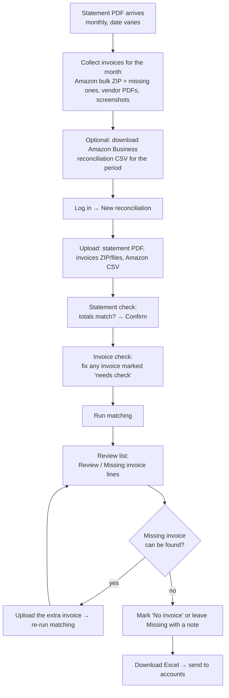
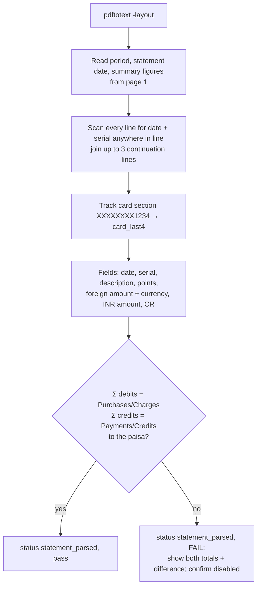
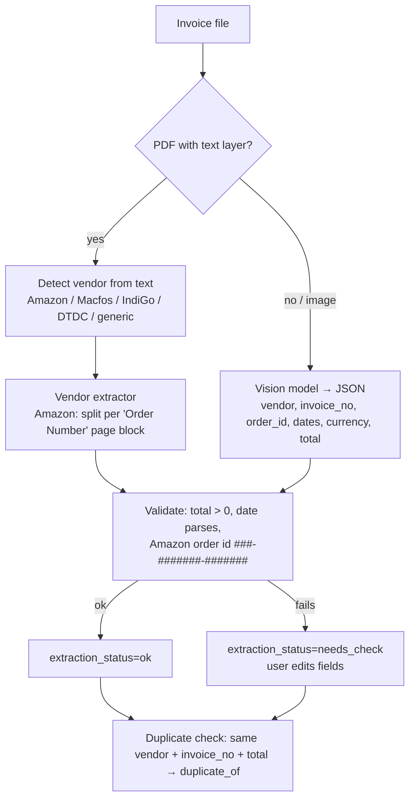

# Flows

This file covers how a month's reconciliation moves through the app, from the user's side and from the system's side. Rules are in `project_context.md` §8; tables and APIs are in `architecture.md`.

## 1. The user's monthly flow



**What the user does, and roughly how long it takes:**

| Step | Who | Time (estimate) |
|---|---|---|
| Download statement PDF from bank | Person | 2 min |
| Amazon Business: bulk invoice ZIP + reconciliation CSV, both for the **whole statement period** (the dates on the Statement step, for June 21 May to 28 June), not the calendar month | Person | ~10 min |
| Fetch invoices missing from Amazon's ZIP (September: 24 of 60 card-paid orders, 40%, had none, and 2 more were only partly invoiced); with the report, the Results step lists them under **Amazon invoices to fetch** | Person | Depends on count |
| Collect other vendors' invoices (email/portal) | Person | As today |
| Upload, confirm statement, fix flagged invoices | Person | ~5 min |
| Read, match, build Excel | App | Minutes |
| Resolve Review / Missing lines | Person | Depends on count (June: 25 lines) |

## 2. Cycle status machine

```mermaid
stateDiagram-v2
  [*] --> draft: create cycle
  draft --> statement_parsed: upload + parse statement (totals checked)
  statement_parsed --> statement_parsed: totals mismatch (banner shown, confirm disabled; user replaces the statement and reads again)
  statement_parsed --> statement_confirmed: user confirms
  statement_confirmed --> invoices_extracted: extract invoices
  invoices_extracted --> matched: run matching
  matched --> matched: resolve lines / upload more invoices + re-run
  matched --> exported: download Excel
  exported --> matched: further edits (export again)
```



Invoices can be uploaded at any time before matching, and also afterwards. After a later upload, extraction runs again for the new files only, and then matching runs again.

## 3. Upload and ingest

```mermaid
sequenceDiagram
  participant FE as Frontend
  participant API
  participant ST as Storage
  participant DB
  FE->>API: POST /cycles/{id}/files (kind, files[])
  loop each file
    API->>API: sha256; if ZIP → expand (skip folders, __MACOSX, hidden files)
    API->>DB: duplicate by (cycle_id, sha256)? → status=duplicate
    API->>ST: put cycles/{cycle}/{file}/{name}
    API->>DB: insert recon_files (kind, mime, parent_file_id)
  end
  API-->>FE: list of files with status
```

**Classification rules:**

- **ZIP content:** files inside a ZIP are classified by the user's chosen `kind` (normally `invoice`).
- **Statements found among invoices:** an "invoice" whose text contains `CREDIT CARD STATEMENT` and `STATEMENT SUMMARY` is marked `ignored`, with the note "copy of the statement". The June ZIP contained one.
- **Rejected types:** anything other than PDF, PNG, JPG/JPEG, ZIP or CSV is rejected with a message.

## 4. Statement processing



**Ignored text:** the boilerplate pages after the transactions contain example tables with amounts. They are never parsed as transactions, because those lines have no `dd/mm/yyyy + 10–12 digit serial` pattern.

## 5. Invoice extraction



**Rule:** the file name is never used as a source of amounts or dates. File names are only shown to the user and written into the Excel.

## 6. Matching

Rules run in a fixed order. The first rule that applies sets the status.

```mermaid
flowchart TD
  M0[Statement lines + invoices<br/>+ Amazon CSV rows if any] --> R1{Fee line?}
  R1 -- yes --> B1[Bank charge]
  R1 -- no --> R2{PAYMENT RECEIVED?}
  R2 -- yes --> B2[Payment]
  R2 -- no --> R3{Credit with matching debit<br/>same merchant, amount, ≤7 days?}
  R3 -- yes --> B3[Reversed - both lines]
  R3 -- no --> R4{Other credit?}
  R4 -- yes --> B4[Credit – manual]
  R4 -- no --> R5{Amazon?}
  R5 -- yes, CSV --> A1[Group CSV card rows by Payment Reference ID<br/>amount equal, date ±3 days → attach invoices of those orders]
  R5 -- yes, no CSV --> A2[Subset of unused invoices,<br/>order date in t-3…t, sum exact]
  R5 -- no --> R6{IndiGo?}
  R6 -- yes --> A3[Subset by invoice date t-3…t+1, prefer one PNR]
  R6 -- no --> R7{Known vendor?}
  R7 -- yes --> A4[Global assignment: exact INR, USD = intl amount,<br/>or within ₹1; invoice date or order date<br/>(incl. Booking Date) ≤7 days]
  R7 -- no --> B9[No invoice]
  A1 & A2 & A3 & A4 --> Q{Found?}
  Q -- unique --> OK[Matched]
  Q -- tie --> RV[Review + suggestion<br/>suggested invoices are reserved]
  Q -- none --> NM{Near miss?<br/>≤5% diff, USD-only invoice,<br/>= same-day credits, duplicate charge}
  NM -- yes --> RV
  NM -- no --> MI[Missing invoice]
```

**Re-running matching** keeps every link and status the user set by hand (`created_by` not null, or the line changed by a person: `updated_by` not null). Only system results are recalculated. A run is a background job: the Results step shows its progress and says when it has finished.

## 7. Review and resolve

For each line with status `Review` or `Missing invoice`, the user can do any of these:

1. Accept the suggestion: attach the suggested invoices, and the status becomes `Matched` with rule `manual`.
2. Search the unused invoices (by vendor, amount or date) and attach any of them.
3. Upload a new invoice file to the cycle, then run matching again.
4. Set the status to `No invoice` with a note.
5. Add a note without changing the status.

Every action writes a `recon_events` row (who, what, when).

## 8. Export

`GET /api/cycles/{id}/export.xlsx` builds the workbook from the current database state. There are three sheets: `Summary`, `<Month YYYY>` and `Invoices not used`. The layout is in `project_context.md` §7.

- **First export:** the cycle status is set to `exported`.
- **Later exports:** always allowed, and each one reflects the latest edits.
- **Editing after an export** is allowed: the first edit (resolving a line, correcting an invoice, uploading or reading files, running matching again) moves the cycle back to `matched`, and every screen shows "Edited since the last export" until the Excel is downloaded again.
